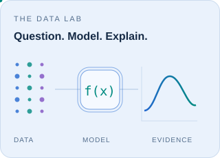

<picture>
  <source media="(prefers-color-scheme: dark)" srcset="assets/header-dark.svg">
  
</picture>

  <a href="https://github.com/Lewis-18/StatM"><strong>Explore StatM ↗</strong></a>
  &nbsp; · &nbsp;
  <a href="https://github.com/Lewis-18/StatM/releases/latest">Download</a>
  &nbsp; · &nbsp;
  <a href="https://github.com/Lewis-18?tab=repositories">Repositories</a>

## About me

<picture>
  <source media="(prefers-color-scheme: dark)" srcset="assets/data-lab-dark.svg">
  
</picture>

Hi, I'm **Jackson Lewis**, based at **Nanjing Agricultural University**.

I am interested in **statistics, mathematical modeling, and scientific visualization**. I enjoy turning recurring problems in data analysis into tools that people can use directly.

I am currently building **[StatM](https://github.com/Lewis-18/StatM)**, an offline desktop application for statistical learning and research workflows.

I care about understanding a model's assumptions, making results reproducible, and presenting evidence clearly.

 

## What I explore

| 📐 Statistical thinking | 🧩 Mathematical modeling |
| :--- | :--- |
| Choosing methods that fit the question, checking assumptions, and interpreting results in context. | Connecting real problems with explicit assumptions, algorithms, and validation. |
| **🎨 Scientific visualization** | **🔁 Reproducible workflows** |
| Turning distributions, relationships, and diagnostics into figures that explain the analysis. | Keeping data, parameters, and analysis history together so a result can be revisited. |

## Featured project · StatM

**From data to evidence, in one local workspace.**

A Windows desktop application for data preparation, statistical analysis, and scientific visualization. Its core workflows run offline, with no separate Python or Node.js setup.

- **Prepare** — import CSV, TXT, and Excel; inspect fields and handle missing or duplicate records.
- **Analyze** — descriptive statistics, correlation, hypothesis tests, OLS regression, and PCA.
- **Explore** — interactive 2D/3D figures and linked scatter selections.
- **Revisit & export** — compare compatible history records; export tables, Python/R scripts, and publication figures.

2D figures support **PNG / SVG / PDF**. The current 3D view supports **PNG / PDF**.

  <a href="https://github.com/Lewis-18/StatM"><strong>Project ↗</strong></a>
  &nbsp; · &nbsp;
  <a href="https://github.com/Lewis-18/StatM/releases/latest">Windows installer</a>
  &nbsp; · &nbsp;
  <a href="https://github.com/Lewis-18/StatM/blob/main/README.en.md">English overview</a>
  &nbsp; · &nbsp;
  <a href="https://github.com/Lewis-18/StatM/blob/main/EXAMPLES.md">Worked examples</a>

## Tools I build with

<picture>
  <source media="(prefers-color-scheme: dark)" srcset="assets/toolkit-dark.svg">
  
</picture>

**Analysis:** SciPy · statsmodels &nbsp; / &nbsp; **Visualization:** ECharts

## Let's connect

I am happy to discuss statistics, modeling, research figures, and practical analysis tools. If you try StatM, your feedback on real workflows is welcome.

[Share a StatM idea or report an issue ↗](https://github.com/Lewis-18/StatM/issues)

---

<em>Start with a question. Understand the model. Explain the result.</em>

